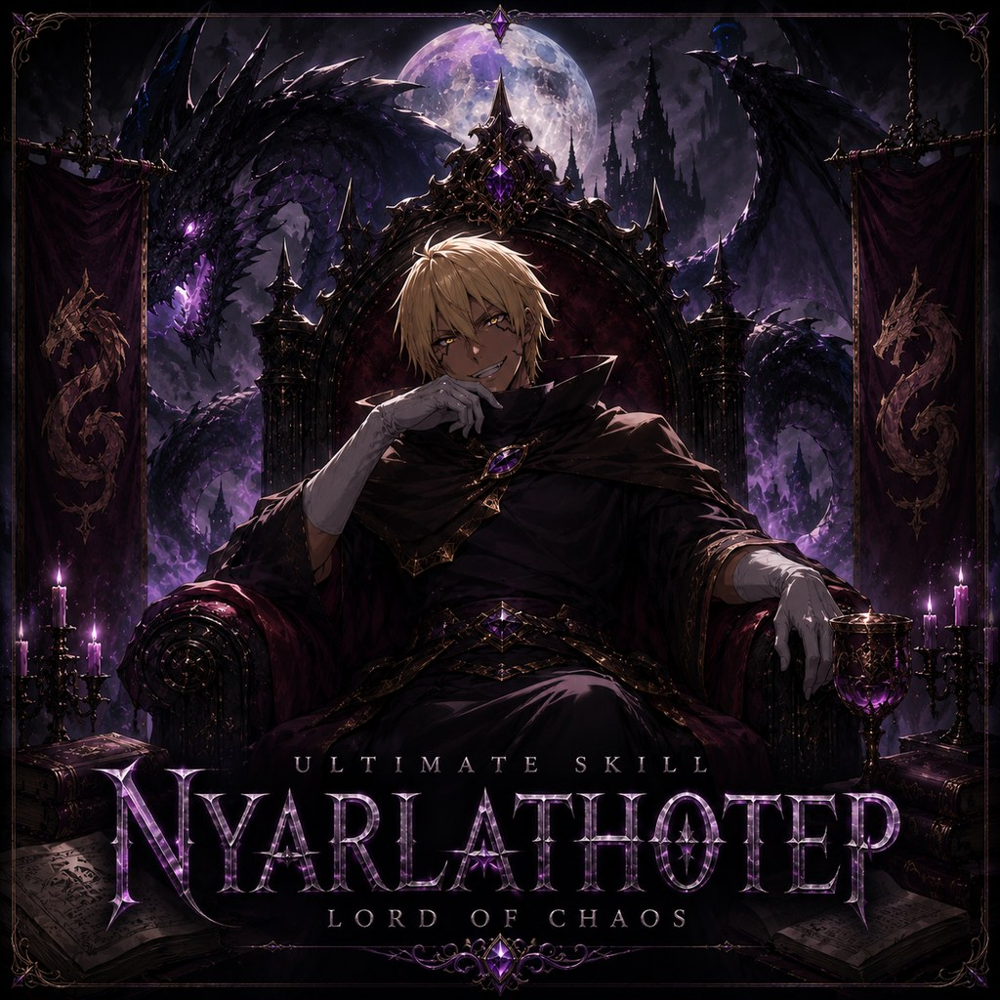

# Nyarlathotep, Lord of Chaos

<p align="center"></p>

A server-side BepInEx IL2CPP plugin for V Rising that stages NPC events the base game doesn't have: empowered
factions, hunting waves, swarms in an arena, region-bound hunting grounds, faction revenge and a map-wide apocalypse.
Admins build events from templates or in chat. Each event starts on a schedule, at nightfall, after a V Blood kill, on
its own, or by command, and everything it spawned is removed when it ends.

Public beta. Every pillar and every automatic announcement starts disabled; admins opt in.

## Status

| Build | What it is |
|---|---|
| [**v0.13.0**](https://github.com/KDavidP1987/Nyarlathotep-Lord-of-Chaos/releases/tag/v0.13.0) | Current release, the Halloween release: the apocalypse, unit watch and wave variety. The test round's workbook is in [`testing/`](testing/). |

What each version shipped: [`CHANGELOG.md`](CHANGELOG.md). What comes next: the Epic plan,
[`docs/dod/nyarlathotep.md`](docs/dod/nyarlathotep.md).

## Quick start

Install the package on a dedicated server and start it once. Then, in game as an admin, with no file edits:

```
.nyar template list
.nyar template use undead-nightfall
.nyar pillar empowerment on
.nyar event enable undead-nightfall
.nyar status
```

At the next nightfall the undead are empowered for 20 minutes, and `.nyar status` shows the event running.
`.nyar purge`, then `.nyar purge confirm`, is the kill switch.

## How it works

Every feature is an **event**: a *trigger* fires an *action* for a *duration*. When the duration ends, everything
the event created is reverted or despawned.

| Triggers | Actions |
|---|---|
| Schedule (days and times), nightfall or daybreak, a V Blood kill, a random interval, a player entering a region, a player killing a faction, faction revenge, an admin command | Empower factions with timed carrier buffs; spawn waves of units, with levels, stat multipliers and a behaviour (hunt nearby players, roam a region, hold an arena, pursue); or run an apocalypse of hordes marching on a goal |

Safety rules hold for every event:

- **Tracked:** every spawned unit is registered and found again by a boot-time sweep, so a crash or restart leaves
  nothing behind.
- **Reversible:** empowerment rides on buffs that expire by themselves. Direct stat writes touch only units the mod
  spawned.
- **Budgeted:** spawns and despawns are staged a few per tick under configurable caps, and one command ends
  everything.
- **Placed with care:** waves spawn on walkable ground, and outside claimed castle territory unless the event allows
  it.

**Scale.** The tick budget, under 5 ms average per one-minute window, is measured at the default caps: 150 tracked
units, with hunting, fan-out, the player-trigger scan and the kill feed included. Raising `MaxTrackedUnits` to
151-500 is best effort. A 250 ms slow-tick warning names the slowest phase.

## Features

| Feature | What it adds | Since | Design doc |
|---|---|---|---|
| Event engine | Triggers, durations, conditions, the kill switch, announcements (wave warnings, banners, a daily banner) | 0.2.0 | [FOUNDATION](docs/features/FOUNDATION.md) |
| Faction empowerment | Five stats ×1.0-3.0 on up to five factions, through timed carrier buffs | 0.4.0 | [FACTION_EMPOWERMENT](docs/features/FACTION_EMPOWERMENT.md) |
| Event library | Built-in templates and chat authoring: create, copy, edit and delete events, switch pillars | 0.5.0 | [EVENT_LIBRARY](docs/features/EVENT_LIBRARY.md) |
| Walkable spawns | Units moved off water, cliffs and walls using the game's tile collision | 0.5.1 | [WALKABLE_SPAWNS](docs/features/WALKABLE_SPAWNS.md) |
| Regions | Triggers and actions scoped to the game's world regions | 0.6.0 | [REGIONS](docs/features/REGIONS.md) |
| Event spawns | Per-unit chance, level and stat modifiers, loot, the Hunt behaviour, waves around a random player | 0.7.0 | [EVENT_SPAWNS](docs/features/EVENT_SPAWNS.md) |
| Automation | Interval, region-entered and faction-kill triggers; one wave spread over several players | 0.8.0 | [AUTOMATION](docs/features/AUTOMATION.md) |
| Wave sets | Each wave with its own units and stats, timed or started when the last is cleared; an event scoreboard | 0.9.0 | [WAVE_SETS](docs/features/WAVE_SETS.md) |
| Swarm | Arenas, waves that grow on their own, a kill-to-death winner | 0.10.0 | [SWARM](docs/features/SWARM.md) |
| Hunting grounds | Waves spread over regions, units kept inside them, groups that hunt the players there | 0.11.0 | [HUNTING_GROUNDS](docs/features/HUNTING_GROUNDS.md) |
| Revenge | A faction hunts a player who kills too many of its units; bosses on an event's last wave | 0.12.0 | [REVENGE](docs/features/REVENGE.md) |
| Apocalypse | A map-wide outbreak of one faction: hotspots, roamers that spread, hordes marching on a goal | 0.13.0 | [APOCALYPSE](docs/features/APOCALYPSE.md) |
| Unit watch | Stuck units moved back to walkable ground, or removed after two tries | 0.13.0 | [UNIT_WATCH](docs/features/UNIT_WATCH.md) |
| Wave variety | Pursuit of players who run, unit pools and boss rolls, the timed and onslaught templates | 0.13.0 | [WAVE_VARIETY](docs/features/WAVE_VARIETY.md) |
| Raphael API | A machine-readable `[NYAR:*]` wire for the Raphael client: status, admin actions, pushes | 0.3.0, api 8 in 0.13.0 | [Contract](docs/RAPHAEL_INTEGRATION_CONTRACT.md) |
| Scaling, replacements, boss reinforcements, live operations, stats, sieges | Planned | — | [Epic plan](docs/dod/nyarlathotep.md) |

## Architecture

| Folder | Holds |
|---|---|
| `Logic/` | The rules, with no game dependency: validation, precedence, schedules, the spawn ledger, the announcer, the wire format. Unit-tested. |
| `Services/` | The game side: `EventStore` and `Persistence` (JSON under `BepInEx/config/Nyarlathotep/`), `TriggerBus` (hooks), `EventScheduler` (one main-thread tick in phases), `EventRuntime`, `SpawnTracker` (budgeted spawns and despawns, the boot sweep), `WaveAction`, `HuntAction`, `EmpowerAction`, `ApocalypseAction`, `TerritoryMap`, `Announcer` |
| `Patches/` | Harmony patches, one file per patched system |
| `Commands/` | The `.nyar` chat commands, and the `.nyar api` reads and admin twins Raphael uses |

Every mutating operation goes through `Logic/ActionGateway`, and every entity write stays in `Services/` or
`Patches/`; `tools/preflight.ps1` checks both statically.

## Repository layout

```
Nyarlathotep/Nyarlathotep/        the C# project (Plugin, Core, Patches, Services, Commands, Config, Logic, Resources)
Nyarlathotep/Nyarlathotep.Tests/  xUnit tests over Logic/ (no game needed)
docs/                             design, feature docs, plans, audits, Raphael contract (index: docs/README.md)
testing/                          the current tester workbook and its PDF
tools/preflight.ps1               release-surface sync and safety checks
tools/rollback-gate.ps1           a release's rollback checks in one command
tools/vrclient/                   automated in-game tests that drive the real client
tools/tester-package/             builds the tester workbook
```

## Building

```powershell
cd Nyarlathotep
dotnet build Nyarlathotep.sln -c Release                                        # build and deploy to a local server
dotnet build Nyarlathotep.sln -c Release -p:VRisingServerPath=C:\__nodeploy__  # compile check only
dotnet test Nyarlathotep.sln                                                    # unit tests
```

Targets `net6.0` with `BepInEx.Unity.IL2CPP` 6.0.0-be.733, `VampireReferenceAssemblies` 1.1.12 and
VampireCommandFramework 0.10. Stop the dedicated server before a deploying build; it locks the DLL.

## Release discipline

Six surfaces move together in one `chore(release): vX.Y.Z` commit: the csproj and toml versions, both changelogs and
both READMEs. Run `pwsh tools/preflight.ps1` first, and `pwsh tools/rollback-gate.ps1 -From <previous tag> -To <new
tag>` on the local tag before pushing.

## Documentation

Start at [`docs/README.md`](docs/README.md). The most used:

- [Design](docs/NYARLATHOTEP_DESIGN.md): architecture, configuration, the command reference (§6), decisions (§9)
- [Feature docs](docs/features/): one per feature, each with its test results
- [Raphael contract](docs/RAPHAEL_INTEGRATION_CONTRACT.md) and the [api 8 handoff](docs/RAPHAEL_HANDOFF_API8.md)
- [Plans](docs/dod/): the Definition-of-Done plans that track every feature

## License

AGPL-3.0-or-later.
